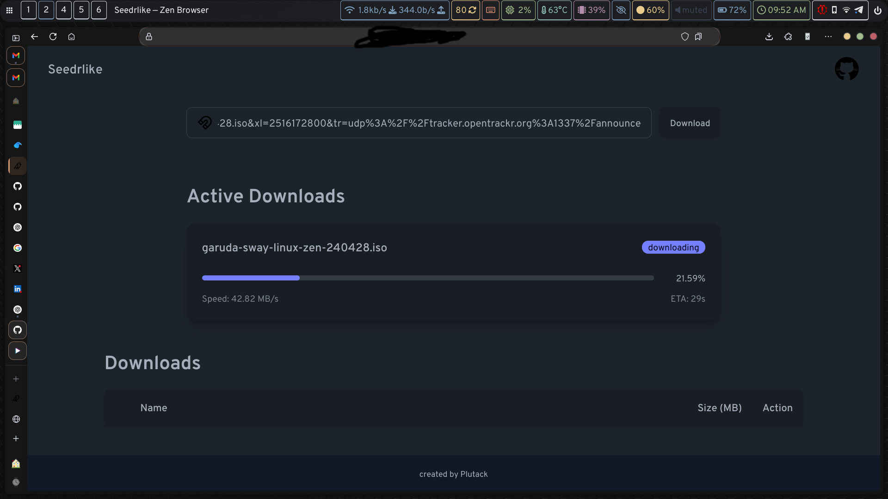
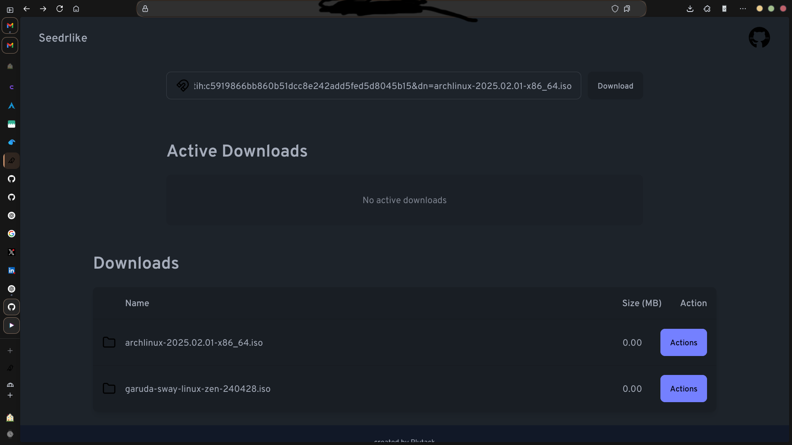

<p align="center"><h1 align="center">SEEDRLIKE</h1></p>
<p align="center">
</p>
<p align="center">
	
	
	
	
</p>
<p align="center"><!-- default option, no dependency badges. -->
</p>
<p align="center">
	<!-- default option, no dependency badges. -->
</p>
<br>

## Table of Contents

- [Overview](#overview)
- [Features](#features)
- [Project Structure](#project-structure)
- [Getting Started](#getting-started)
  - [Prerequisites](#prerequisites)
  - [Installation](#installation)
  - [Usage](#usage)
  - [Live app](#live-app)
- [Project Roadmap](#project-roadmap)
- [Contributing](#contributing)
- [License](#license)
- [Acknowledgments](#acknowledgments)

---

##  Overview
Seedrlike is inspired by [Seedr](https://seedr.cc). This allows the user to add magnet links to which in turn makes them available for download over https.

---

##  Features
- Initiate downloads using magnet links
- Websocket for real time updates (tracking download progress and time to complete)
- Select individual torrent files before downloading, with selected size totals
- Upload a `.torrent` file with validated metadata and active-duplicate detection
- Durable MySQL queue with partial-download verification after restart
- Search your accessible file library and sort by name, size, or date
- Verified email notifications, configurable under Settings
- Administrator-only capacity dashboard and aggregate 30-day outcome counters

### Feature configuration and deployment

The application automatically applies pending embedded Goose migrations on startup, before starting torrent clients, remote API calls, workers, or HTTP routes. No separate Goose CLI installation or manual `goose up` is needed. Existing `goose_db_version` history is respected. A database-scoped MySQL advisory lock serializes startup migrations (60-second lock wait, five-minute startup deadline). Migration failures stop startup rather than running against an incompatible schema.

Create the database itself first and set `GOOSE_DBSTRING` to a user with the required schema-change permissions (`CREATE`, `ALTER`, `INDEX`, and normal data access). The app creates tables, not the database or DB account. Back up production databases before deploying schema changes. MySQL DDL is not fully transactional: after a failure, inspect partially applied changes and migration history before restarting; the app does not silently mark failed migrations as applied or automatically roll back. Goose CLI remains available for operator-managed inspection/rollback. No download history screen or manual retry feature is added.

- `DOWNLOAD_DIR` defaults to `./data/downloads`. Keep it on persistent storage alongside a persistent MySQL database. New jobs use isolated UUID directories; old downloads from the former hardcoded location are not automatically imported.
- `MAX_ACTIVE_DOWNLOAD_GB` controls the shared reservation budget. Reservations conservatively cover the full torrent plus ZIP allowance, including unselected boundary-piece data. Only selected files are staged and uploaded.
- Adding, previewing, importing, and cancelling downloads requires login. Users may cancel only their own jobs, before zipping/uploading begins.
- Individual magnets and torrent search results default to **Download all**. **Choose files** is an optional secondary action, with all files initially selected. Upload one `.torrent` file (up to 4 MB) to download all its files, or use **Choose files** to preview its embedded metadata immediately and select individual files, including files inside nested directories. No peer lookup is required for uploaded-file preview, and preview does not queue a download or retain an upload on disk. Only selected files are staged/uploaded, optionally bundled as ZIP; shared BitTorrent boundary pieces may require downloading bytes from unselected neighboring files. Original metadata—including private flags and tracker tiers—is retained while queued, then removed from disk when downloading starts (the running client keeps it in memory). After a restart during downloading, metadata must be fetched from peers again using the persisted magnet; offline metadata recovery is no longer available at that stage. V1 and hybrid torrents are supported; v2-only files are rejected explicitly. Batch magnet import has been removed. The queue currently accepts up to 10 unfinished jobs globally.
- Login offers **Remember me** for a 30-day persistent session. Without it, the login cookie lasts for the browser session and the token expires after 24 hours. Keep `JWT_SECRET` strong and unchanged across restarts/replicas; changing it invalidates existing logins. Logout clears the browser cookie.
- `/settings` lets each user set a notification email separately from their username, verify it, choose ready/failed notifications, and send a test message. Verification links expire after 30 minutes and require a signed-in confirmation. Verification/test requests are rate-limited.
- Email delivery uses the official Resend Go SDK v4 and its fixed HTTPS API endpoint (`https://api.resend.com`), not SMTP. Set required `APP_BASE_URL` (a trusted administrator-controlled HTTPS origin, with no credentials, path other than `/`, query, or fragment), `RESEND_API_KEY` (no whitespace), and `RESEND_FROM` (a mailbox on your Resend-verified domain, optionally with a display name). Optional `RESEND_TIMEOUT` defaults to `10s` and must be between `1s` and `1m`. See [the example configuration](<.envrc.example>) and [notification documentation](<internal/notifications/README.md>). For development only, optional boolean `EMAIL_ALLOW_INSECURE_LOCALHOST=true` permits an HTTP application origin on localhost or a literal loopback IP; it never changes the Resend HTTPS endpoint or disables certificate verification. Old `SMTP_*` variables are no longer used. Follow [Resend's Go SDK guide](https://resend.com/docs/send-with-go) and [verified-domain documentation](https://resend.com/docs/dashboard/domains/introduction).
- `ADMIN_USERNAME` designates an existing account that can access `/admin`. The server checks authorization before exposing global jobs, filesystem capacity, reservations, or outcome counters. Normal users see only accessible library content and job updates.
- Production origin policy: when `APP_BASE_URL` is set, every browser mutation (POST/DELETE) must carry a matching `Origin`, so the value must exactly match the origin users actually browse — scheme, host, and port (`https://seed.example`, not `http://…`, `https://www.seed.example`, or an embedded comment/quote). Configure it in the hosting platform's environment (for example Coolify's Environment Variables); `.envrc`/direnv only affects local shells and is never read by deployments. Without `APP_BASE_URL`, mutations fall back to comparing against the forwarded `Host`, which proxies may rewrite. The startup log line `same_origin_policy app_base_url=…` shows the value the server actually received; rejected requests log `request_origin_rejected` with the browser `origin`, the configured `app_base_url`, and the forwarded `host`.

**Restart safety:** queued and downloading jobs are restored and partial torrent data is rechecked. Zipping can be rebuilt. A job interrupted during remote upload is marked failed rather than automatically uploaded again: Gofile uploads are not idempotent, and remote files may already exist. Failed local artifacts remain under `DOWNLOAD_DIR/jobs/<job UUID>` for operator inspection and manual removal after reconciliation; this can consume disk space. Successful/cancelled artifacts are cleaned up. Use a single application worker process per database/data directory.

**Deletion behavior:** authorized single-item and stale cleanup requests attempt the corresponding Gofile deletions, then remove the targeted database records regardless of remote errors, partial failures, or already-missing items. All stale file and folder batches are attempted even when an earlier batch fails. Remote failures are logged, not shown as local-deletion failures; remote items may remain after local records are removed. Ownership checks, root protection, and transactional local cleanup remain enforced. Database failures still return an error.

**Storage privacy:** account ownership restricts app listings, job updates, and mutations. The existing Gofile integration still publishes folders/direct download links, including the shared root; this is not private encrypted storage. Do not upload sensitive files or treat app login as a Gofile access-control boundary.

**Notifications:** ready emails are triggered only after successful remote upload, not torrent completion. Delivery is best effort with bounded Resend API request timeouts, not a durable email outbox. Actual sending is blocked in Go test binaries; injected fake HTTP transports can test SDK payloads offline.

### Logging

Application logs use Go `log/slog` with JSON output to stdout. `LOG_LEVEL` accepts `debug`, `info` (default), `warn`, or `error`; an invalid value stops startup. Normal logs include startup/migration steps, download job lifecycle and stage changes, capacity waits, terminal outcomes, and actionable reason codes. Upload progress and routine health/static/WebSocket chatter are DEBUG to avoid flooding normal logs.

HTTP logs include generated `request_id` (also returned as `X-Request-ID`), method, route template, response status, bytes, and duration. They intentionally omit query strings, bodies, cookies, authorization headers, client IPs, and user-supplied request IDs. Job logs use `job_id`, stage/status, selected/reserved bytes, and safe failure reason codes. Errors record their type rather than raw external error text, which could expose credentials, tokens, email addresses, filenames, or paths. Third-party dependency logs may retain their own logging behavior.

---

##  Project Structure

```sh
└── seedrlike/
    ├── Dockerfile
    ├── cmd
    │   └── main.go
    ├── generate.go
    ├── go.mod
    ├── go.sum
    ├── internal
    │   ├── api
    │   ├── core
    │   └── database
    ├── seedrlike
    ├── sqlc.yaml
    ├── tailwind.config.js
    └── views
        ├── assets
        ├── components
        └── layouts
```


---
##  Getting Started

###  Prerequisites

Before getting started with seedrlike, ensure your runtime environment meets the following requirements:

- **Programming Language:** Go
- **Package Manager:** Go modules
- **Container Runtime:** Docker


###  Installation

Install seedrlike using one of the following methods:

**Build from source:**

1. Clone the seedrlike repository:
```sh
❯ git clone https://github.com/plutack/seedrlike
```

2. Navigate to the project directory:
```sh
❯ cd seedrlike
```

3. Install the project dependencies:

Create your MySQL database and set the environment variables shown in `.envrc.example`. The application embeds and applies pending migrations automatically at startup. For local development, direnv is recommended. The Goose CLI is optional for database inspection and operator-managed rollback.

**Using `go modules`** &nbsp; [](https://golang.org/)

```sh
❯ go build
```

**Using `docker`** &nbsp; [](https://www.docker.com/)

```sh
❯ docker build -t {image_name} .
```


###  Usage
On startup, Seedrlike connects to the configured database and applies pending migrations automatically. Startup stops if migration fails.
Run seedrlike using the following command:
**Using `go modules`** &nbsp; [](https://golang.org/)

```sh
❯ go run ./cmd/main.go
```


**Using `docker`** &nbsp; [](https://www.docker.com/)

```sh
❯ docker run -it -p 3000:3000 {image_name}
```

### Live-app




---
##  Project Roadmap

- [X] **`Task 1`**: <strike>Fix bug: websocket complete event is not sent sometimes</strike>
- [x] **`Task 2`**: Bug: Fix file display size.
- [ ] **`Task 3`**: Feat:Add test files.
- [x] **`Task 4`**: Feat: Keep track of file status during upload stage and send websocket events based on them.
- [ ] **`Task 5`**: Feat: Switch to viper to handle config variables

---

##  Contributing

- **💬 [Join the Discussions](https://github.com/plutack/seedrlike/discussions)**: Share your insights, provide feedback, or ask questions.
- **🐛 [Report Issues](https://github.com/plutack/seedrlike/issues)**: Submit bugs found or log feature requests for the `seedrlike` project.
- **💡 [Submit Pull Requests](https://github.com/plutack/seedrlike/blob/main/CONTRIBUTING.md)**: Review open PRs, and submit your own PRs.

<details closed>
<summary>Contributing Guidelines</summary>

1. **Fork the Repository**: Start by forking the project repository to your github account.
2. **Clone Locally**: Clone the forked repository to your local machine using a git client.
   ```sh
   git clone https://github.com/plutack/seedrlike
   ```
3. **Create a New Branch**: Always work on a new branch, giving it a descriptive name.
   ```sh
   git checkout -b new-feature-x
   ```
4. **Make Your Changes**: Develop and test your changes locally.
5. **Commit Your Changes**: Commit with a clear message describing your updates.
   ```sh
   git commit -m 'Implemented new feature x.'
   ```
6. **Push to github**: Push the changes to your forked repository.
   ```sh
   git push origin new-feature-x
   ```
7. **Submit a Pull Request**: Create a PR against the original project repository. Clearly describe the changes and their motivations.
8. **Review**: Once your PR is reviewed and approved, it will be merged into the main branch. Congratulations on your contribution!
</details>


---

##  License

This project is protected under the [GLWTS Public License](./LICENSE.md) License. 

---

##  Acknowledgments

- @Melkeydev - [go-blueprint](https://github.com/Melkeydev/go-blueprint)
- @anacrolix - [anacrolix/torrent](https://github.com/anacrolix/torrent)

---
